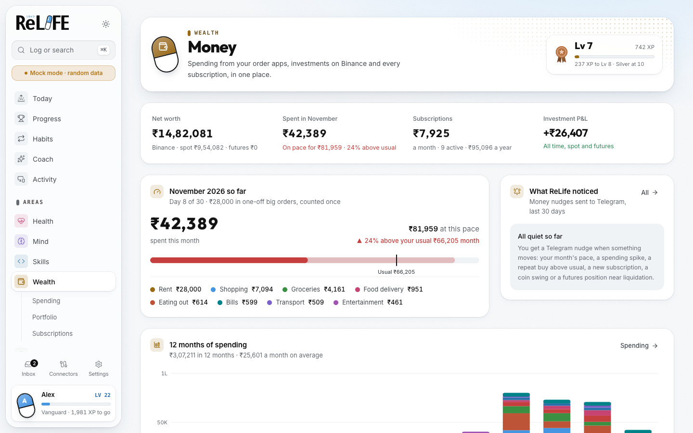

# ReLife

Level up your real life, one day at a time. ReLife is a life RPG: it tracks Health, Mind, Skills, Wealth,
Hobbies and People in one place, pulls in what it can on its own (Binance, your order apps, GitHub, your laptop,
bank SMS, Gmail), gives you daily quests, and messages you on Telegram when something in your data deserves a
look. An AI model of your choice turns the numbers into quests, nudges and plans.

Local-first: everything runs on your machine, and your data stays in your own Postgres.

<picture>
  <source media="(prefers-color-scheme: dark)" srcset="docs/images/today-dark.png">
  
</picture>

<picture>
  <source media="(prefers-color-scheme: dark)" srcset="docs/images/wealth-dark.png">
  
</picture>

Screenshots use mock data (`npm run dev:mock`).

**How it all works:** open [docs/architecture.html](docs/architecture.html) in a browser for the full guide with
diagrams (processes, data flow, data model, job engine, nudges, AI, security and trade-offs).

## What's inside

- **Today** (`/`): the quest log. Routines and medicines due, daily goals like water, and The System's quests
  for the day.
- **The System**: daily quests in the style of Solo Leveling. The AI picks what to train from what's slipping and
  what you want to improve; tested rules keep it fair (targets near your usual, ranks E–S, penalty and emergency
  quests). It also spots spending habits from order items, like a soft drink bought on most days, and sets at
  most one habit quest a day.
- **Progress** (`/profile`): your character sheet. Level, title, streak, the week per area, consistency,
  achievements, weekly quests, chests and streak freezes.
- **Areas**: Health, Mind, Skills, Wealth, Hobbies and People, each opening with its key numbers, then charts
  and routines.
- **Wealth**, from your real data:
  - **Overview**: this month's pace against a usual month (one-off big orders counted once), 12 months of
    spending by category, the apps you order from, repeat buys, investments, subscriptions, all-time totals and
    the latest money nudges.
  - **Spending**: by category, merchant and item, with habits and every transaction.
  - **Portfolio**: Binance spot and futures. Open positions first with a runway to liquidation, holdings,
    where the profit and loss came from (spot and futures only, FIFO), and every trade, P2P order, transfer and
    reward.
  - **Subscriptions**: what renews and when, with logos and an add or edit dialog.
- **Activity** (`/activity`): time per site and app, from the Chrome extension and a Mac app watcher.
- **Habits**: every routine, medicine and tracker, with streaks and history.
- **Insights**: alerts, nudges, weekly reviews and plans, and questions about your data.
- **Inbox**: messages that couldn't be read and payments without a category.
- **Connectors**: connect data sources, Telegram and AI providers. Each shows when it last synced and when it
  syncs next.
- **Welcome** (`/welcome`): first-run setup for your region, goals and starter routines.

## Nudges

ReLife watches your data and messages you on Telegram when something moves: a spending spike, the month heading
over your usual, a repeat buy above its usual, a new subscription, a coin swing, or a futures position close to
liquidation. Code works out every number; the AI only decides what's worth a message and words it as a short,
phone-style notification. Each topic is sent at most once a day (weekly trends once a week), at most two a day,
and never in quiet hours. A position within 5% of its liquidation price is always sent.

Checks run hourly in the daytime and the moment new data lands (a sync, new orders, a subscription added).
Every message goes through one outbox, so Settings → Notifications decides quiet hours, daily caps and repeats
per category.

## Run it

Requirements: Node 20.9+, Docker, and Google Chrome for the shopping-app connectors.

```bash
npm install                     # also turns on the git hooks
cp .env.example .env            # only DATABASE_URL is required
docker compose up -d            # Postgres on 127.0.0.1:5442
npm run db:push                 # create tables
npm run dev                     # http://127.0.0.1:3030 plus the worker
```

Two processes start together:

- **web**: the Next.js dashboard and server actions.
- **worker**: the job engine (connector syncs, parsing, reminders, nudges, XP, quests, AI), the Telegram bot and
  the Mac app watcher. The Connectors page shows a notice when it isn't running.

Jobs live in Postgres, so a restart never loses or repeats one: missed daily jobs catch up once, failed syncs
back off, and a connector syncs as soon as you connect it.

ReLife uses port 3030 because 3000 is often taken by other projects, and two dev servers on one port make pages
reload endlessly.

### Run it in the background (recommended for daily use)

```bash
npm run build
npm run service -- install      # starts at login, restarts if it crashes; http://127.0.0.1:3030
npm run service -- restart      # after pulling or changing code: rebuilds, then restarts
npm run service -- logs         # follow ~/Library/Logs/ReLife/relife.log
npm run service -- stop         # before `npm run dev`, which uses the same port
npm run service -- uninstall    # remove it
```

It runs the production build (`npm start`) from a LaunchAgent in `~/Library/LaunchAgents/com.relife.app.plist`.
Postgres comes back on its own (`restart: unless-stopped`) once Docker Desktop starts at login.

**Make it feel like an app:** open http://127.0.0.1:3030 in Chrome and choose **Install ReLife** in the address
bar menu (Safari: **File → Add to Dock**). It gets a Dock icon and its own window.

## Connect your data

Open **Connectors** in the sidebar. Nothing syncs until you connect it. **Connect** asks for that service's keys
and stores them encrypted in your local database; values already in `.env` fill any field you leave blank.

| What | You need | Guide |
|---|---|---|
| Reminders, nudges, quick logging, `/ask` | Telegram bot token and your chat ID | [CONNECTORS.md](docs/CONNECTORS.md) |
| Binance: spot, futures, P2P, Convert, deposits, rewards | Read-only API key | [CONNECTORS.md](docs/CONNECTORS.md#binance) |
| Zomato, Swiggy, Blinkit, Zepto, Flipkart, Amazon orders with items | Log in once in a Chrome window ReLife opens | [CONNECTORS.md](docs/CONNECTORS.md) |
| GitHub commits, PRs and reviews | Fine-grained token | [CONNECTORS.md](docs/CONNECTORS.md#github) |
| Codeforces, AtCoder, CodeChef, Lichess, Chess.com | Your public handle | Connectors page |
| Laptop time per site and app | The browser extension and a shared token | [extension/README.md](extension/README.md) |
| Bank SMS, steps, sleep (iPhone) | iOS Shortcuts writing to an iCloud Drive file | [SHORTCUTS.md](docs/SHORTCUTS.md) |
| Bank alerts and order emails | Gmail OAuth (`scripts/gmail-auth.ts`) | [CONNECTORS.md](docs/CONNECTORS.md#gmail) |
| Exchange rates | Nothing: connect FX | Connectors page |
| AI | A key for Anthropic, OpenAI, Google or OpenRouter, or a local model | Connectors page |

Prefer a vault? Keep keys in [dotsafe](docs/CONNECTORS.md) and start with `npm run dev:vault`.

Binance's API only reaches back about 1.5–2 years. For older trades, download the Transaction History statement
and run `npx tsx --env-file=.env scripts/binance-import.ts <file.csv>`.

## Daily use

- **⌘K** logs anything: `water 250`, `mood 4`, `read 30 min`, `spent 120 chai`.
- **Telegram**: tap ✅ on reminders, 💬 Why? on a nudge, and use `/today`, `/quests`, `/status`, `/log`,
  `/spent`, `/mood`, `/sleep`, `/wake` and `/ask`.
- **Subscriptions**: press **Add subscription**, pick a service or type any name, and you get a reminder before
  each charge.
- **Inbox** lists messages that couldn't be read and payments without a category. Fix a category once and
  ReLife remembers it for that merchant.

## Mock mode

`npm run dev:mock` fills a separate `relife_mock` database with about four months of random data and opens it on
http://127.0.0.1:3001, so you can check every page with something on it. Your real data is never touched. Stop
`npm run dev` first; the two share a build folder. `npm run mock:seed -- 42` reseeds with a fixed seed.

## Commands

| Command | What it does |
|---|---|
| `npm run dev` | Web + worker with reload, on port 3030 |
| `npm run dev:vault` | The same, with keys injected from a dotsafe vault |
| `npm run dev:mock` | Random data in `relife_mock`, on port 3001 |
| `npm run build && npm start` | Production mode |
| `npm run service -- install` | Run in the background at login (see above) |
| `npm test` | Domain, parser, connector, job engine, nudge and key-encryption tests |
| `npm run typecheck` | TypeScript |
| `npm run db:push` | Apply schema changes |
| `npx tsx --env-file=.env scripts/binance-import.ts <csv...>` | Import Binance trade exports or Transaction History statements |

## Contributing

Rules for code, data, UI and commits are in [AGENTS.md](AGENTS.md); coding agents read the same file. The design
and its reasoning are in [docs/SYSTEM_DESIGN.md](docs/SYSTEM_DESIGN.md) and the guide in
[docs/architecture.html](docs/architecture.html). Animation audits and plans live in [plans/](plans/README.md).

Adding things is one file plus one line: a connector in `src/connectors/`, a message format in `src/parsers/`
(with a fixture), an alert in `src/rules/`, a job in `src/jobs/index.ts`, an AI job in `src/ai/jobs/`.

Git hooks in `.githooks/` (turned on by `npm install`) keep the repo clean:

- **pre-commit** blocks secret-looking strings, `.env` files, `data/`, keys and database dumps, iCloud
  duplicates like `routes 2.ts`, and files over 2 MB.
- **pre-push** runs the typecheck and tests.

Never commit real bank messages, account numbers or screenshots of your own data. Parser fixtures and
screenshots use fake data (`npm run dev:mock`).

## Privacy and security

- The web server binds to 127.0.0.1, and the Telegram bot answers only your chat.
- Connector keys are encrypted with AES-256-GCM. The encryption key is created in `data/secret.key` on first
  use, or set `RELIFE_SECRET_KEY`. Back it up with your database: without it, saved keys can't be read and
  you'll need to enter them again.
- Exchange keys must be read-only; the Binance connector refuses keys that can trade or withdraw.
- Shopping apps are read through your own logged-in Chrome profile, kept in `data/browser/`. This is for
  personal use only.
- The browser extension sends only to your own ReLife, never in incognito, and only the site, path and title of
  the tab in front.
- Prompts mask account numbers and UPI handles unless you set `LLM_MASK=false`. Parsing can run on a local model
  so bank SMS never leaves your Mac. Every AI call is logged with its cost in `llm_runs`.

## Phone access

Install [Tailscale](https://tailscale.com) on the Mac and iPhone, run the dashboard with
`next dev -H 0.0.0.0 -p 3030` or put it behind `tailscale serve`, and open it from Safari. Add it to the Home
Screen to use it as an app. Nothing is exposed to the internet.

## License

[AGPL-3.0-or-later](LICENSE). You can use, change and self-host ReLife freely. If you run a modified version as
a service for other people, you must share your changes under the same license. Vendored components keep their
own MIT notices (see Credits).

## Credits

- Charts and motion components: [beUI](https://beui.dev) (MIT).
- Connector and brand logos (`public/connectors`, `public/brands`): [Simple Icons](https://simpleicons.org)
  (CC0) and [Lobe Icons](https://github.com/lobehub/lobe-icons) (MIT); a few brands Simple Icons doesn't carry
  use their own app icons. Coin logos come from [CoinGecko](https://www.coingecko.com) and are cached locally.
  Trademarks belong to their owners.
- Routine, hobby and shopping-category pictures (`public/routines`, `public/hobbies`, `public/categories`):
  [Fluent Emoji](https://github.com/microsoft/fluentui-emoji) by Microsoft (MIT).
- The ReLIFE name and logo (`assets/brand/`, `public/brand/`, `src/app/icon.png`, `src/app/apple-icon.png`)
  belong to their owners (© YayoiSo/comico/ReLIFE Laboratory) and are used as a fan tribute. They are not
  covered by this project's AGPL license.
