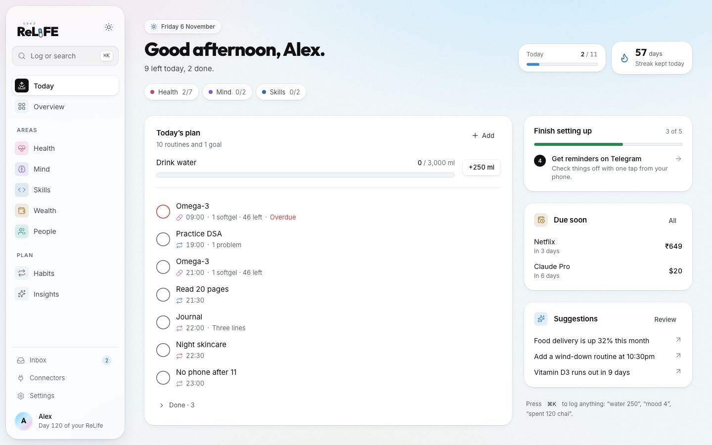

# ReLife

A second chance, built from small daily changes. ReLife tracks Health, Mind, Skills, Wealth and
People in one place, pulls in what it can automatically (Binance, GitHub, bank SMS, Gmail), reminds
you on Telegram, and lets an AI model of your choice turn the data into nudges and plans.

Local-first: everything runs on your machine, and your data stays in your own Postgres.

<picture>
  <source media="(prefers-color-scheme: dark)" srcset="docs/images/today-dark.png">
  
</picture>

## What's inside

- **Today**: what to do now. Routines, medicines, daily goals like water, payments due, suggestions.
- **Overview**: how it's going. Daily streak, one headline number per area, a consistency grid and
  trends.
- **Areas**: Health, Mind, Skills, Wealth (spending, portfolio, subscriptions) and People. Each opens
  with its key numbers, then charts and routines.
- **Habits**: every routine, medicine and tracker, with streaks and 14-day history.
- **Insights**: ask questions about your data and review weekly reviews and plans from your model.
- **Connectors**: connect data sources, Telegram and AI providers.

## Run it

Requirements: Node 20.9+, Docker.

```bash
npm install                     # also turns on the git hooks
cp .env.example .env            # only DATABASE_URL is required
docker compose up -d            # Postgres on 127.0.0.1:5442
npm run db:push                 # create tables
npm run dev                     # http://127.0.0.1:3030 plus the worker
```

Two processes start together:

- **web**: the Next.js dashboard.
- **worker**: Telegram bot, reminders, connector syncs, alerts and AI jobs. The Connectors page shows
  a notice when it isn't running.

ReLife uses port 3030 because 3000 is often taken by other projects, and two dev servers on one port
make pages reload endlessly.

## Connect your data

Open **Connectors** in the sidebar. Everything starts as "Not connected". **Connect** asks for that
service's keys and stores them encrypted in your local database. Values already in `.env` fill in any
field you leave blank.

| What | You need | Guide |
|---|---|---|
| Reminders, quick logging, `/ask` | Telegram bot token and your chat ID | [CONNECTORS.md](docs/CONNECTORS.md) |
| Bank SMS, steps, sleep (iPhone) | iOS Shortcuts writing to an iCloud Drive file | [SHORTCUTS.md](docs/SHORTCUTS.md) |
| Binance trades and balances | Read-only API key | [CONNECTORS.md](docs/CONNECTORS.md#binance) |
| GitHub commits and PRs | Fine-grained token | [CONNECTORS.md](docs/CONNECTORS.md#github) |
| Axis alerts, Zomato / Zepto / Blinkit orders | Gmail OAuth (`scripts/gmail-auth.ts`) | [CONNECTORS.md](docs/CONNECTORS.md#gmail) |
| AI | A key for Anthropic, OpenAI, Google or OpenRouter, or a local model | Connectors page |

## Daily use

- **⌘K** logs anything: `water 250`, `mood 4`, `read 30 min`, `spent 120 chai`.
- **Telegram**: tap ✅ on reminders, `/today`, `/log`, `/spent`, `/sleep`, `/wake`, `/ask`.
- **Inbox** lists messages that couldn't be read and payments without a category. Fix a category
  once and ReLife remembers it for that merchant.

## Mock mode

`npm run dev:mock` fills a separate `relife_mock` database with about four months of random data and
opens it on http://127.0.0.1:3001, so you can check every page with something on it. Your real data
is never touched. Stop `npm run dev` first; the two share a build folder. `npm run mock:seed -- 42`
reseeds with a fixed seed.

## Commands

| Command | What it does |
|---|---|
| `npm run dev` | Web + worker with reload, on port 3030 |
| `npm run dev:mock` | Random data in `relife_mock`, on port 3001 |
| `npm run build && npm start` | Production mode |
| `npm test` | Domain, parser, worker and key-encryption tests |
| `npm run typecheck` | TypeScript |
| `npm run db:push` | Apply schema changes |
| `npx tsx --env-file=.env scripts/binance-import.ts <csv...>` | Import Binance trade history exports |

## Contributing

Rules for code, data, UI and commits are in [AGENTS.md](AGENTS.md). Coding agents read the same file.
The design and its reasoning are in [docs/SYSTEM_DESIGN.md](docs/SYSTEM_DESIGN.md).

Git hooks in `.githooks/` (turned on by `npm install`) keep the repo clean:

- **pre-commit** blocks secret-looking strings, `.env` files, `data/`, keys and database dumps,
  iCloud duplicates like `routes 2.ts`, and files over 2 MB.
- **pre-push** runs the typecheck and tests.

Never commit real bank messages, account numbers or screenshots of your own data. Parser fixtures and
screenshots use fake data (`npm run dev:mock`).

## Privacy and security

- The web server binds to 127.0.0.1, and the Telegram bot answers only your chat.
- Connector keys are encrypted with AES-256-GCM. The encryption key is created in `data/secret.key`
  on first use, or set `RELIFE_SECRET_KEY`. Back it up with your database: without it, saved keys
  can't be read and you'll need to enter them again.
- Exchange keys must be read-only; the Binance connector refuses keys that can trade or withdraw.
- Prompts mask account numbers and UPI handles unless you set `LLM_MASK=false`. Parsing can run on a
  local model so bank SMS never leaves your Mac.

## Phone access

Install [Tailscale](https://tailscale.com) on the Mac and iPhone, run the dashboard with
`next dev -H 0.0.0.0 -p 3030` or put it behind `tailscale serve`, and open it from Safari. Add it to
the Home Screen to use it as an app. Nothing is exposed to the internet.

## License

[AGPL-3.0-or-later](LICENSE). You can use, change and self-host ReLife freely. If you run a modified
version as a service for other people, you must share your changes under the same license. Vendored
components keep their own MIT notices (see Credits).

## Credits

- Charts: [dither-kit](https://tripwire.sh/dither-kit) (MIT). Motion components: [beUI](https://beui.dev) (MIT).
- Connector logos: [Simple Icons](https://simpleicons.org) (CC0) and [Lobe Icons](https://github.com/lobehub/lobe-icons) (MIT).
  Trademarks belong to their owners.
- The ReLIFE name and capsule logo come from the anime (© YayoiSo/comico/ReLIFE Laboratory). They
  are fine for a private build. Replace them before any public release.
