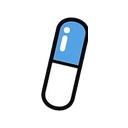

# ReLife browser extension

ReLife in your toolbar. The popup's **Today** tab shows your level, today's quests and routines (check them off
there) and takes quick logs. In the background it measures focused time on each site (and YouTube video, and course
page) and sends it to **your own** ReLife on this computer. Nothing goes anywhere else.

## Install (Chrome, Arc, Brave, Edge)

1. In ReLife, open **You › Connections → Laptop activity**, put any long random text in **Extension token**
   (e.g. from `openssl rand -hex 24`) and press Connect.
2. Open `chrome://extensions`, turn on **Developer mode**, press **Load unpacked** and choose this `extension` folder.
3. Click the ReLife icon in the toolbar, open **Connection**, paste the same token and press **Save and test**.

## Today, from the toolbar

The popup opens on **Today** (it remembers the tab you last used):

- Your level and title, XP to the next level, XP earned today, your streak (amber until you've done something today)
  and streak freezes.
- **Quick log** takes the same words as ⌘K and Telegram: `water 250`, `mood 4`, `coffee 2`, `spent 120 chai`.
  Opened with the shortcut, the box is ready to type into.
- **Quests**: the System's quests with their rank, progress and XP (your data clears them), quantity goals with a
  one-tap **+250**, and today's routines and medicines. Tap a routine's box to check it off or undo it. Level-ups
  and achievements show as a toast.
- **Screen time** today by kind, with a link to Activity.

The **This page** tab has what it had before: the site's time and what it counts as, and its library item.

The toolbar icon shows how many quests and routines are still open, a tick once everything's done, `off` while
paused and `!` when ReLife can't be reached. Turn the number off on the settings page.

## Shortcuts and menus

- `Alt+Shift+R` opens the popup; `Alt+Shift+P` pauses or resumes tracking. Change them at `chrome://extensions/shortcuts`.
- Right-click the toolbar icon for **Pause tracking**, **Send to ReLife now** and **Open ReLife**.

## Settings page

Right-click the icon → **Options** (or the gear → **Sites, library and shortcuts**): the connection, sync status
(last send and any error, what's waiting) with **Send now**, the sites you don't track (add or remove), the items
tracked from this browser, and the shortcuts.

## What it records

- The site, page path (no query string) and page title of the tab in front, while you're active or a video
  is playing. Idle for 2 minutes, another app in front, or a locked screen stops the clock.
- On YouTube, the channel name too, so lessons count as learning and the rest as entertainment.
- On anything you chose with **Track this…** (a course, show or anime, video series, book): the lesson or
  episode and "x of y" progress when the page shows it. Shows and YouTube playlists are matched by series,
  so every episode counts toward the same item. Its cover picture (or the site's icon) is copied once into
  ReLife's `data/library`.

## Shows, anime and courses, on their own

While an episode or lesson plays (Crunchyroll, Netflix, Hotstar, course sites, YouTube playlists…), its series is
added to ReLife's Library by itself, no "Track this" needed: a show or anime on an entertainment site, a course on a
learning one. Each episode is logged for good: its name, number and season, its length, how far in you got and the
time spent. Library cards show the last one and open the full list. Detection reads the page's structured data
(TVEpisode, Episode, VideoObject), its meta tags or the series link and heading; just browsing a show's page doesn't
add it.

## Choosing what a site counts as

The popup shows the site you're on (with its time today and what it counts as: tap a chip to change it), the course or show it belongs to, and today's time by kind. The gear opens the connection settings.
ReLife re-sorts that site's past time too. The same picker is on ReLife's Activity page, next to each site.
Sites and Mac apps the built-in list doesn't know are sorted once by your AI model (only the site or app name is
sent), and your own choice always replaces that guess.

Never recorded: incognito windows, sites you exclude from the popup, page contents, keystrokes, form fields.
Click the **Tracking** pill at the top of the popup (or press `Alt+Shift+P`) to pause everything until you resume; the eye button next to a site stops tracking that site.

## How it sends

Every 30 seconds it posts the current stretch and any finished ones to `POST /api/activity` with your token.
If ReLife isn't running, it keeps up to 2,000 stretches and sends them later, even after the browser restarts.
Every two minutes (and when the popup opens) it reads `GET /api/companion` for the Today tab and the badge;
checks, goal adds and quick logs go to `POST /api/companion`. The same token covers both.

## Updating

After pulling a new version, press the reload arrow on the ReLife card in `chrome://extensions`, then refresh the
tabs that were already open. Chrome keeps the old copy running in open tabs until they reload; it stops on its own
and no longer logs "Extension context invalidated", but it doesn't track either.

Uploads are clipped to what ReLife accepts, so an unusually long page title can't block the queue, and a long
offline backlog goes out in batches.
